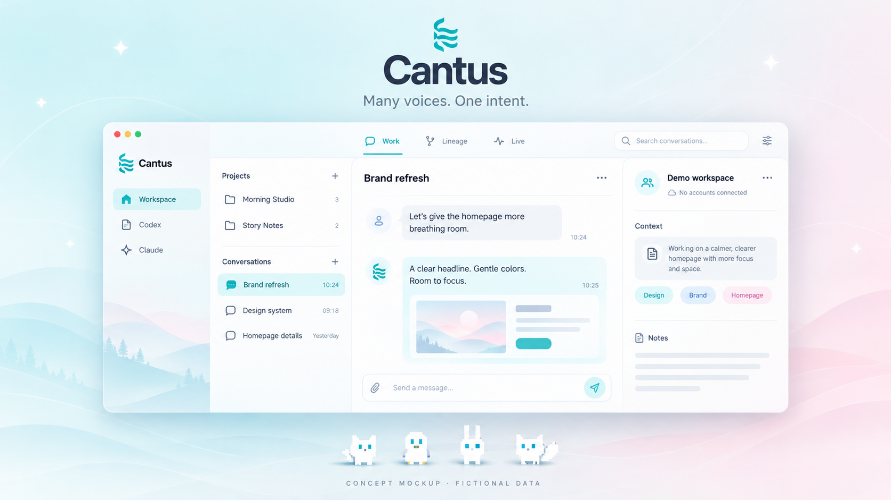
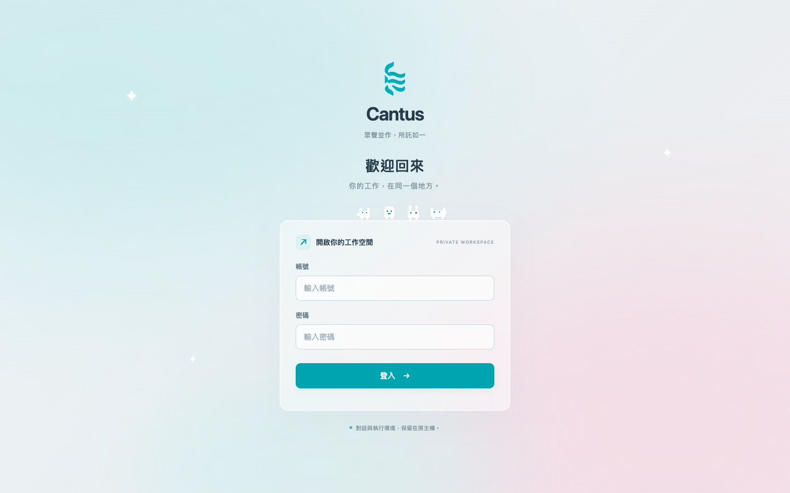
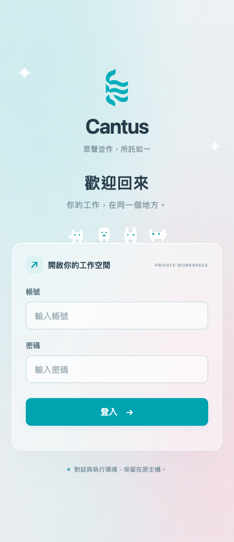

<div align="center">

# Cantus

### 眾聲並作，所託如一。

讓散落在 Codex 與 Claude 裡的對話，回到同一個安靜的工作空間。

**Work · Lineage · Live**

[開始體驗](#開始體驗) · [畫面預覽](#畫面預覽) · [連接自己的資料](docs/SETUP.md) · [隱私與邊界](docs/PRIVACY.md)

</div>



> 上圖為 AI 製作的概念示意，不是實際操作截圖。它展示視覺方向，不代表已實作的所有細節。下方登入畫面才是真實介面截圖。

## 一個地方，三種視角

| 視角 | 能做的事 | 不會擅自做的事 |
| --- | --- | --- |
| **Work** | 右鍵改名、新增 Cantus 資料夾、收納未分類對話 | 不改原始標題，不搬動來源檔案 |
| **Lineage** | 合併兩台工作站的關係圖，明確派工並保留收據 | 不從標題猜關係，不因斷線自動重送 |
| **Live** | 查看由這個面板啟動的工作狀態 | 不掃描其他主機、不把離線當作完成 |

柔和的冰藍與淡粉、乾淨的留白、可折疊的長訊息與程式碼。重要內容留在眼前，其餘細節需要時再打開。

手機採用獨立的全螢幕清單與對話，底部切換三種視角；「工作區」切換主機與設定，「更多」查看對話資訊，列上的「⋯」可改名與分類。返回清單保留未送出的草稿，輸入區支援可用畫面高度變動，橫放仍使用手機介面。已以瀏覽器觸控模擬驗證，實體手機鍵盤與 Safari 體驗仍需實機驗收。

手機輸入框整合文字、派工圖示與送出鍵；點派工圖示開啟原生選單，閒置時不顯示 `idle`。送出圓鈕為 36px，點擊範圍保留 44px。Claude／Codex 的服務標示使用 [官方品牌圖樣](docs/BRAND-ASSETS.md)，不再用字母代替。

## 畫面預覽

### 登入 · 桌面



### 登入 · 手機

<div align="center">

</div>

四隻像素小角色陪你進入工作區；開啟系統「減少動態效果」時會停止動態。截圖只展示空白表單，沒有任何登入資料。

## 開始體驗

需要 **Node.js 24 或更新版本**。沒有需要下載的 npm 套件；來源讀取元件已放在 `vendor/`。

```bash
git clone https://github.com/arumwu/cantus-panel.git
cd cantus-panel
npm start
```

開啟 <http://127.0.0.1:4589>。

預設就是 **虛構資料示範**：兩個來源、十段虛構會話。不讀取你的帳號或歷史，不啟動 AI，不需要 API key。關係整理與規則預覽可在本機操作，產生的狀態放在不追蹤的 `state/`。

此儲存庫公開分享程式與虛構展示資料，不包含既有部署的接線或私人工作資料。

## 連接自己的資料

示範、來源閱讀、AI 執行是三個分開的層級。必須自行填入設定並明確啟用，才會接觸真實資料。

```bash
cp config/local.example.json config/local.json
# 編輯 config/local.json，只保留你要連接的來源與路徑。
CANTUS_MODE=local npm start
```

這時可閱讀已設定的來源，AI 執行仍然關閉。完整設定、選用的登入入口、啟用執行的注意事項，見 [SETUP.md](docs/SETUP.md)。

## 開發與驗證

```bash
npm test
npm run check:privacy
```

測試涵蓋專案與分支、關係驗證、修訂衝突、切換模型的上下文邊界、停止行為、預設不連線、登入與來源限制。測試使用虛構資料或替代的執行器，不呼叫付費 AI。

四隻像素角色沿主框上緣移動；登入後只顯示「登出工作區」。切換來源時會丟棄舊請求，避免誤寫到另一個工作區。預設只有單機示範；[雙工作站模式](docs/PAIR.md) 需自行設定連線，repo 不包含私人主機接線。

回覆中可以繼續輸入，按「加入排隊」會在本回合完成後依序送出，也可取消待送訊息。排隊綁定原工作區與對話，切換畫面不會改送到另一台主機；需要保持分頁開啟。重新整理後保留的隊列先暫停，由你確認繼續；失敗、停止或結果不明時不會自行重送。這是排隊，不是中途插入正在執行的回合。

Codex、Claude 都使用相同排隊流程。選用的瀏覽器測試在 `cloud/message-queue-ui.test.cjs`，使用虛構回覆；需已有 Playwright 與 Chrome，可用 `PLAYWRIGHT_MODULE`、`CHROME_PATH` 指定本機位置，不會自動安裝或呼叫真實 AI。

這些測試不代表所有原生 CLI 版本、真實帳號或正式部署都已驗收。分享版的登入入口連到一個本機控制端；選用的第二台工作站由你自行設定，不附帶既有部署或跨主機接線。

## 專案結構

```text
app.js / index.html / style.css   主介面
conversation-tree.js             專案與分支
lineage*.cjs / lineage-ui.js      工作關係
native.cjs / managed.cjs         選用的原生執行
handoff.cjs / routing*.cjs       對話切換與規則
cloud/                          選用的獨立登入入口
demo.cjs                        純虛構示範資料
config/local.example.json       不含接線資料的設定範本
vendor/session-exporter/        本機來源讀取元件
docs/                           設定、隱私、展示素材
```

## 授權與聲明

Cantus 目前未提供開源授權（`UNLICENSED`）；公開可見與允許自由再利用是不同的事。第三方元件沿用其原始 MIT 授權，見 [第三方聲明](vendor/session-exporter/NOTICE) 與 [LICENSE](vendor/session-exporter/LICENSE)。

這是獨立專案，並非 OpenAI 或 Anthropic 官方產品。Codex 與 Claude 名稱及商標屬於各自權利人。
